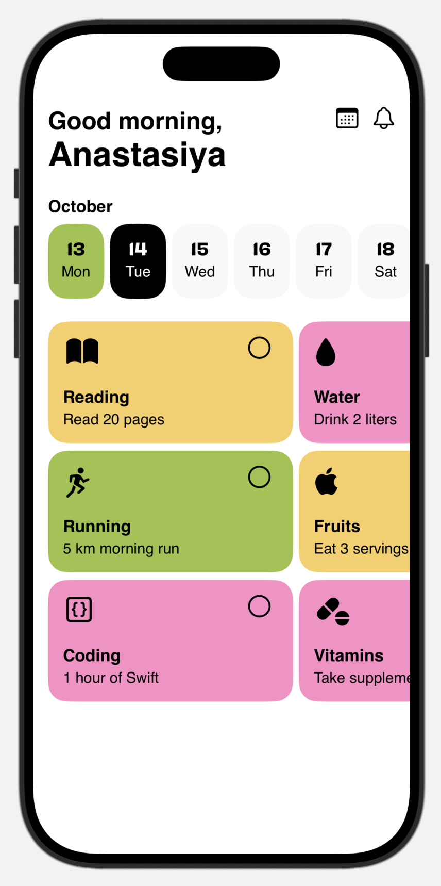

# HabitBuddy — iOS Habit Tracker (in development)

**HabitBuddy** is a social habit tracker that helps users build and maintain healthy routines — together.
You can track your daily progress, see your friends’ achievements, and motivate each other to stay consistent.

## Features

* **Track daily habits** — mark completed tasks and view your progress.
* **Social motivation** — (planned) connect with friends, share updates, and support each other.
* **Statistics** — (planned) weekly and monthly analytics.
* **Reminders** — (planned) notifications to keep you on track.

## Tech Stack

* **SwiftUI** — UI and animations
* **MVVM** — architecture
* **Firebase (planned)** — user data and sync
* **iOS 17+**

## Current Progress

Main screen UI with habit list and progress tracking
Features in progress: habit creation screen, authentication, social feed, and analytics

## Preview

